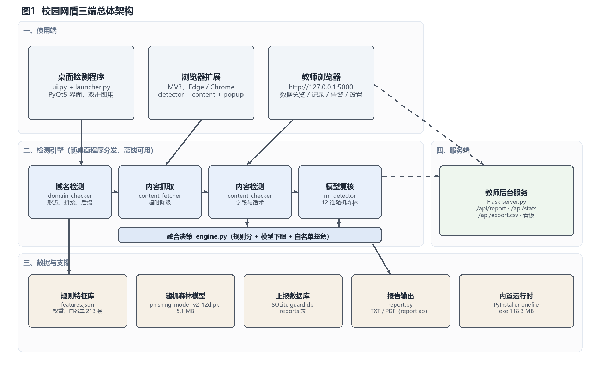

# 校园网盾 · 高校钓鱼网页轻量检测助手

**Campus Net Shield** — 离线运行、结论可解释、面向高校仿冒场景的钓鱼网页检测工具。

桌面端（PyQt5）+ 浏览器扩展（Chrome/Edge MV3）+ 教师后台（Flask）三端一体，输入网址十秒内给出 0—100 分风险等级与命中原因，不联网上传任何数据。

> 闽南科技学院 · 挑战杯科技发明制作 B 类参赛作品 · v2.3（2026-11）



## 为什么做

高校是钓鱼攻击的集中场景，但攻击者很少伪造完全陌生的站点，而是把真实校名、真实徽标、真实官方域名拼进地址，再套一个与教务系统一致的登录框。通用黑名单对此有两处不适应：

1. **时滞**。针对单所学校的仿冒域名从上线到被商业库收录通常要数小时乃至更久，而这批域名只影响一所学校，采样规模决定收录优先级。
2. **黑箱**。商业库只给"危险/安全"两态，学生看不到判断依据，也就学不会识别。

本作品把校园场景中最典型的三类手法——官方域名被拼接进子域、官方主名被形近替换、校内话术配合敏感表单——做成显式判据，每条结论都附命中原因。

## 检测方法

**域名层规则**（`src/desktop/detector/domain_checker.py`）

| 判据 | 分值 |
|---|---|
| IP 直连 | 20 |
| 与官方主名形近（Levenshtein 相似度 ≥ 60） | 40 |
| 官方主名＋连字符/下划线/数字蹭名 | 40 |
| 子域内嵌官方完整域名 | 40 |
| 子域层级 ≥ 3 层 | 15 |
| 可疑子域词 | 15 |
| 可疑后缀 | 10 |
| 主机名 > 40 字符 | 5 |
| 连续数字 ≥ 6 位 | 5 |

**内容层规则**（`content_checker.py`）：抓取页面后检查敏感词（学号、密码、身份证、缴费）、密码框、表单提交域，单页上限 40 分。

**灰区随机森林**（`ml_detector.py`）：规则分落在 31—65 的灰区才交给模型，输入 12 维域名结构特征（host_len、main_len、digit_ratio、special_ratio、subdomain_depth、has_suspicious_sub、tld_suspicious、is_ip、similarity_to_official、starts_with_official、hyphen_count、vowel_ratio）。

**融合方式**：模型概率不折算相加，而是按档抬升分数下限（0.95→68、0.88→55、0.80→45、0.70→38），避免"算得准也改不了结论"。

**分级**：≤30 安全、31—65 可疑、>65 高危。

**白名单前置**：本校官方域、`edu.cn`/`gov.cn` 后缀与 213 条可信域名不进入形近判定与模型复核。

## 实测指标（2026-11-24—25，Windows 11）

| 口径 | 精确率 | 召回率 | F1 | 误报率 | 准确率 |
|---|---|---|---|---|---|
| 规则 + 随机森林双引擎 | 100.00% | 66.00% | 0.7952 | 0.00% | 83.17% |
| 仅机器学习 | 80.58% | 83.00% | 0.8177 | 19.61% | 81.68% |

- 样本：202 条域外标注集（正 100 / 负 102），逐条结果见 `data/v23_202.json`
- 域内 39 条构造仿冒集检出 33 条（84.6%），分组结果见 `data/v23_39.json`
- 单页平均检测 1.21 秒（8 条实测，0.19—3.2 秒）
- 内置模型 5.1 MB，exe 111.7 MB（117 133 718 字节，SHA-256 前 16 位 `2172D6960AC5E402`）

## 快速开始

```bash
pip install -r requirements.txt

# 桌面端
python src/desktop/launcher.py

# 教师后台
python src/admin/server.py     # 浏览器访问 http://127.0.0.1:5000

# 浏览器扩展
# Edge 打开 edge://extensions，开启开发人员模式，加载 src/extension 目录
```

需要打包 exe 时按 `docs/源码构建说明.docx` 中的 PyInstaller 命令。

## 目录结构

```
src/desktop/     PyQt5 桌面端（13 个模块 2 254 行）+ 模型与特征库
src/extension/   Chrome/Edge MV3 扩展（detector 327 / background 214 / content 78 / popup 101 行）
src/admin/       Flask 教师后台（server.py 645 行）+ 演示库
data/            标注集、训练集、逐条结果、复现脚本；generalization/ 为多校泛化实验
docs/            十份定稿文档：作品说明、项目介绍、研究报告、测试数据记录表、功能完备性检查报告、
                 源码构建说明、扩展使用说明、测试数据索引、规则覆盖度分析、多校泛化验证
images/          架构图、流程图与三端界面截图
videos/          桌面端、扩展、后台三段演示
```

## 可复现

`data/` 内含 202 条与 39 条的逐条结果（含每条规则的分数、命中原因与模型概率）、训练集、评测脚本。报告中每个指标都可用 `python data/final_metrics.py` 重算，未做人工修正。

## 已知局限

1. **12 维特征只看域名结构**，路径与页面内容尚未进入特征空间。34 条漏检均为"域名干净、问题在路径或内容"的样本，这是当前最大的能力缺口。
2. **评测集为自建**，正样本来自公开钓鱼域名清单，负样本来自常见站点，同源风险存在；换用真实负样本重训后在 202 条上 F1 降至 0.52—0.57，跨分布泛化仍待验证。
3. **形近规则暂未校验后缀一致性**，在 Tranco 前 2 万实测有 12 条正规站被判 40 分可疑（hku.hk、ku.edu、msu.edu 等），加后缀约束可归零。
4. **仅在 Windows 11 单机验证**，Windows 10 与多机一致性未测。
5. **教师后台无鉴权**，仅监听 127.0.0.1，正式部署需补登录与告警处置闭环。

## 许可与声明

MIT License，见 `LICENSE`。作者：林锦轩、庄园；指导教师：余嘉琳。

本工具仅用于校园安全教育与安全研究，检测结果不构成对目标站点的定性结论；请勿用于任何未授权的测试或攻击行为。
